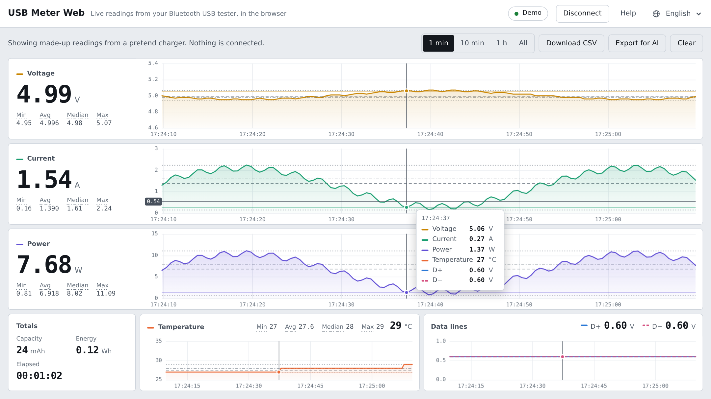

[English](README.md) · 日本語

<div align="center">

# USB Meter Web

**Bluetooth の USB テスターを、ブラウザの全画面ダッシュボードで。**

### [USB Meter Web を開く →](https://usbmeter.koeda.me/?lang=ja)

<picture>
  <source media="(prefers-color-scheme: dark)" srcset="docs/images/hero-dark.png">
  
</picture>

[](https://github.com/koedame/usbmeter/actions/workflows/check.yml)


[使い方](#使い方) · [コマンドライン版](#コマンドライン版) · [ライセンス](#ライセンス)

</div>

Bluetooth 対応の USB テスター（J7-C・ATorch UD18・AT24 など）の値を、ブラウザのダッシュボードで
見るためのページです。アプリのインストールもアカウントも要りません。画面は日本語で表示されます
（ブラウザの言語に合わせて選ばれ、右上の一覧から変えられます）。

## できること

- 電圧・電流・電力を大きな数字とグラフで同時に表示。温度と D+/D− もその下に並びます
- グラフは全部同じ時間軸。どれかにポインタを置くと、その瞬間の全部の値が出ます
- 表示している範囲（1 分・10 分・1 時間・全部）の最小・平均・中央値・最大
- 記録は CSV で保存できます
- 「AI 用にエクスポート」は、記録の CSV と、測ったもの・各列の意味・分析の進め方を書いた README を
  1 つの ZIP にします。Claude や ChatGPT に渡して日本語で質問すれば、説明なしで分析が始まります
  （README は英語で書かれています）。同じ内容の Claude 用スキルも `skills/usbmeter-analysis` にあります
- Bluetooth の一覧にはメーターだけが並びます
- 値はブラウザの中だけで扱い、どこにも送りません

## 使い方

1. Chrome か Edge（Windows・macOS・ChromeOS・Android。Linux の Chrome は、先に
   `chrome://flags/#enable-experimental-web-platform-features` を有効にします）で
   [usbmeter.koeda.me](https://usbmeter.koeda.me) を開きます。
2. メーターを充電器と測りたい機器の間に挿します。挿したままだったときは、一度抜いて挿し直します。
3. すぐに「メーターに接続」を押して、一覧からメーターを選びます。J7-C は `UC96_BLE` という名前で出ます。

**一覧にメーターが出ないときは、メーターを抜いて挿し直し、すぐにもう一度「メーターに接続」を押してください。**
J7-C など、電源が入った直後しか見つからないメーターがあります。

iPhone・iPad の Safari は Web Bluetooth に対応していません。メーターが手元に無くても、「デモを試す」で画面を試せます。

## コマンドライン版

何時間・何日も記録するときは、ブラウザのタブより `usbmeter` コマンド（[`cli/`](cli)）が向いています。
Windows・macOS・Linux で動き、バックグラウンドで記録し続けます。メーターが切れても戻ればつなぎ直して
同じファイルに書き続けます。CSV は「CSV をダウンロード」と同じ列です。

```
usbmeter scan                         # 近くのメーターを出す
usbmeter record --out readings.csv    # Ctrl+C か SIGTERM まで記録する
```

- 報告ごとに 1 行書いてすぐ保存します。落ちても失うのは最後の 1 行までで、履歴はメモリに溜めません。
  既にあるファイルには追記します。`--out` を省くと、今のフォルダーに `usbmeter-<日付>.csv` を作ります。時刻は UTC です
- メーターが戻ったらつなぎ直し、切れた・つながった時刻を標準エラーに 1 行ずつ出します。
  J7-C は電源が入った直後しか見つからないので、戻らなければ挿し直してください
- Ctrl+C と SIGTERM では、行の途中で切らずに終了コード 0 で終わります
- 通信はメーターとだけです。更新の確認もテレメトリもありません

入れ方（Rust でビルドします）と、バックグラウンドで回す設定（Linux の systemd・macOS の launchd・
Windows のタスク スケジューラ）は、英語の README の節 [“Command line”](README.md#command-line-record-without-a-browser-tab) にあります。

## ライセンス

MIT（[LICENSE](LICENSE)）。ATorch・各メーカー・AI の提供元とは関係ありません。製品名は各社のものです。
ページもコマンドライン版も現状のまま提供します。値が間違っていることもあります。校正された計測器でも安全装置でもないので、
回路・充電器・家電が安全かどうかの判断には使わないでください。

サイトの `robots.txt` にある `Content-Signal` は、ページを巡回する側への意思表示で、ライセンスの
条件ではありません。MIT ライセンスは変わらず、ソースコードは学習を含むどの用途にも、その条件で使えます。
