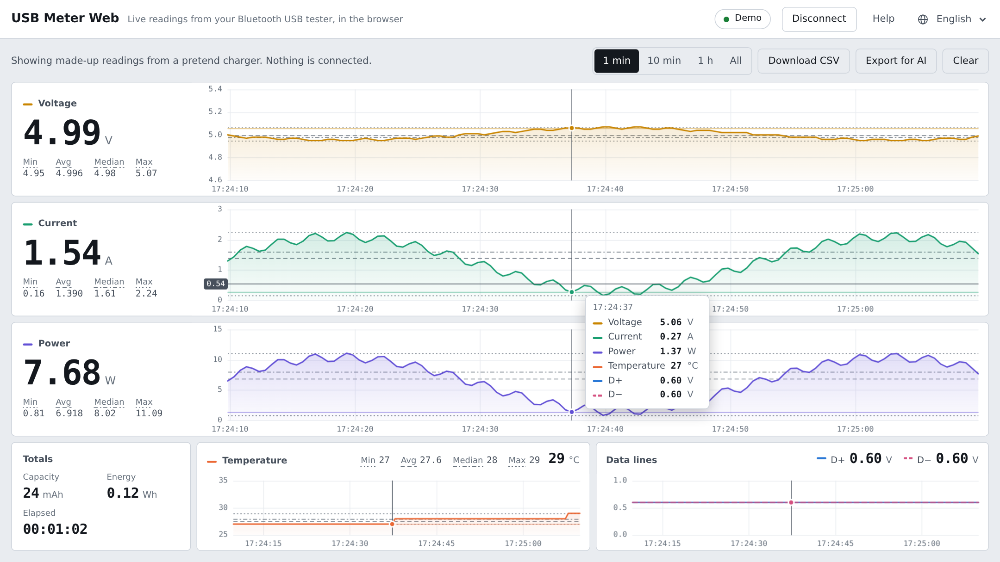

English · [日本語](README.ja.md)

<div align="center">

# USB Meter Web

**Your Bluetooth USB tester on a full-screen dashboard, right in the browser.**

### [Open USB Meter Web →](https://usbmeter.koeda.me)

<picture>
  <source media="(prefers-color-scheme: dark)" srcset="docs/images/hero-dark.png">
  
</picture>

[](https://github.com/koedame/usbmeter/actions/workflows/check.yml)


[Use it](#use-it) · [Supported meters](#supported-meters) · [Analyse with AI](#analyse-a-recording-with-ai) · [Command line](#command-line-record-without-a-browser-tab) · [Privacy](#privacy)

</div>

Cheap USB testers like the **J7-C** and the **ATorch UD18** measure well, but their phone apps
are slow to pair, full of ads or no longer updated. USB Meter Web reads the same Bluetooth
stream straight from the meter and shows everything it sends, all at once. No app to install,
no account, no ads.

## Highlights

- **Every reading at a glance, on one time axis.** Voltage, current and power each get a large
  readout and their own graph. Temperature and the USB data lines (D+/D−) sit below, next to
  capacity, energy and elapsed time. Point at any graph and a cursor reads out every value at
  that moment, so you can see what the voltage did when the current jumped. A level line
  follows the pointer and reads out its height on the axis.
- **Min, average, median and max** of voltage, current, power and temperature for the last
  minute, 10 minutes, hour or the whole recording, drawn as guide lines across each graph.
- **CSV export, ready for AI analysis.** Download the recording and keep working on it in a
  spreadsheet or a script. **Export for AI** packs it into a ZIP with a README that tells
  Claude, ChatGPT or any other assistant what you measured, what every column means and how to
  analyse it. You ask the question; the explaining is done.
- **Private by design.** Readings stay in your browser and are never sent anywhere. No cookies,
  no analytics.
- **Desk or pocket, in 11 languages.** The dashboard fills a monitor and stacks into one column
  on a phone, in light or dark. English, Deutsch, Español, Français, Italiano, Português
  (Brasil), Русский, 日本語, 한국어, 简体中文 and 繁體中文: the page starts in the language your
  browser asks for and has a list for choosing another.
- **No meter at hand?** **Try the demo** plays a pretend charger so you can look around first.

## Use it

1. Open [usbmeter.koeda.me](https://usbmeter.koeda.me) in **Chrome or Edge**.
2. Plug the meter between a charger and the device you want to measure. If it was plugged in
   already, unplug it and plug it back in.
3. Choose **Connect to meter** straight away and pick the meter in the browser's Bluetooth list.
   A J7-C shows up as `UC96_BLE`, ATorch meters under their model name (`UD18-BLE`, `AT24-BLE`,
   ...). The list shows meters, not your keyboard, mouse and earbuds. Readings start at once.

**Meter not in the list?** Unplug it, plug it back in and choose **Connect to meter** again
straight away. Some meters, the J7-C among them, can only be found shortly after they get power,
so one that has been on for a while stays out of the list. The page says so next to the button,
too.

If that does not help: a meter is listed only while the browser can hear it, so it needs to be
nearby, with its Bluetooth switched on and no other connection, because these meters talk to
one device at a time. Close the phone app first. Still missing? Cancel the list and choose
**Show all Bluetooth devices**. When the page does not know the name of a meter connected that
way, it says so; please [open an issue](https://github.com/koedame/usbmeter/issues) with that
name so it can be added.

## Analyse a recording with AI

A recording can answer questions such as *how long did the charge take, and when did it start to
taper?*, *does this charger hold its voltage?*, *how much does this power bank really deliver?*
or *what does my project draw on average?* An AI assistant can work that out, provided it knows
what it is looking at. **Export for AI** takes care of that:

1. Record, then choose **Export for AI**.
2. Pick what you measured: charging a device, a charger or power supply, a power bank or
   battery, a cable, the power draw of a device, or an appliance on an AC meter. Add a note if
   you like, such as "65 W charger, 1 m cable, phone starting at 20 %".
3. Give the downloaded ZIP to Claude, ChatGPT or another assistant and ask your question. If it
   does not take ZIP files, unpack it and give it both files. The README in the ZIP is written
   in English whatever language the page is in; ask in your own language and the assistant
   answers in it.

The ZIP holds two files:

- `readings.csv`: the readings, the same file **Download CSV** gives.
- `README.md`: the meter, the time span, your purpose and notes, and a summary (the range of
  every reading, energy and charge totals, pauses in the recording). Then a guide for the
  assistant: what each column means, what a meter like this can and cannot measure, how to read
  the USB data lines, and what to work out for your kind of test.

The page still sends nothing anywhere. The ZIP goes only where you put it.

### Claude skill

The guide is also a [Claude skill](skills/usbmeter-analysis/SKILL.md). With the skill added,
Claude has the guide at hand even when it gets only the CSV.

- **Claude:** on the page, under **Help**, choose **Download the Claude skill** and add that ZIP
  as a skill ([how to add a skill](https://support.claude.com/en/articles/12512180-use-skills-in-claude)).
- **Claude Code:** copy the folder `skills/usbmeter-analysis` into `~/.claude/skills/`.

## Supported meters

| Meter | Type | Status |
|---|---|---|
| J7-C | USB | Checked against frames recorded from a real J7-C (values match its screen) |
| ATorch UD18 and similar | USB | Checked against published sample packets |
| ATorch AC meters (AT24, AT3010) | AC | Checked against published sample packets. Adds frequency and power factor |
| ATorch DC meters (DT24, DT3010) and others with the same protocol | DC | Experimental: voltage, current, power, temperature and time. Capacity and energy are not decoded yet, because the published layouts disagree |

The type (USB, DC or AC) is read from the data, so a model that is not listed may still work.
If your meter connects but shows nothing, please open an issue with its name and model.

## Browser support

The page uses Web Bluetooth, which **Chrome and Edge** provide on Windows, macOS, ChromeOS and
Android. On Linux, Chrome keeps it switched off until you enable
`chrome://flags/#enable-experimental-web-platform-features`. Firefox and Safari do not support
it, and neither do browsers on iPhone and iPad (except apps that add it, such as Bluefy). The
demo works everywhere.

## Command line: record without a browser tab

For a recording that has to run for hours or days, the browser is a poor host: a tab that sleeps,
a browser that updates or a screen that locks stops it. `usbmeter` in [`cli/`](cli) is the same
recorder as a program for Windows, macOS and Linux. It runs in the background, keeps writing
when the meter drops off and comes back, and writes the same CSV as **Download CSV**, so the
Claude skill above and any spreadsheet read it as they read the page's.

```
usbmeter scan                          # the meters in range
usbmeter record --out readings.csv     # record until Ctrl+C or SIGTERM
usbmeter record --device UC96_BLE --out -    # one meter by name or address, CSV on standard output
```

- **One row per report, written at once.** A crash loses at most the last row, and nothing is
  kept in memory. A file that exists is appended to (a header is written only to an empty one).
  Without `--out`, a new `usbmeter-<date>.csv` is made in the current directory. Times are UTC.
- **It reconnects.** When the meter drops off, `usbmeter` waits, connects again when the meter
  advertises and goes on writing to the same file. When the link is lost and found again, a line
  says so on standard error. A J7-C advertises only shortly after it gets power: if it does not
  come back, unplug it and plug it in again.
- **It stops cleanly.** Ctrl+C and SIGTERM end the program between two rows with exit code 0.
- **On a terminal** the latest reading is shown on one line. Anything else prints nothing but
  the recording.
- **It talks to nobody but the meter.** No update check, no telemetry, no network code at all.

### Install

Build it with [Rust](https://rustup.rs) (the CI also builds it for Linux on x86_64 and aarch64,
macOS on Apple silicon and Intel, and Windows, and keeps the binaries with the licenses of
their dependencies as an artifact of each run of the `cli` workflow):

```
cd cli && cargo build --release      # the program is target/release/usbmeter
```

On Linux you need BlueZ running and the D-Bus library (`libdbus-1-dev` and `pkg-config` to
build, `libdbus-1-3` to run). macOS asks for the Bluetooth permission the first time. On Windows
the computer needs a Bluetooth adapter that supports Low Energy.

### Run it in the background

<details>
<summary>Linux (systemd), macOS (launchd) and Windows (Task Scheduler)</summary>

These examples start the recorder at login and start it again when it stops by itself. Change
the paths and the meter name; `usbmeter scan` shows the name.

**Linux (systemd user unit).** `~/.config/systemd/user/usbmeter.service`:

```ini
[Unit]
Description=USB meter recorder

[Service]
ExecStart=%h/bin/usbmeter record --device UC96_BLE --out %h/usbmeter/readings.csv
Restart=on-failure
RestartSec=10

[Install]
WantedBy=default.target
```

```
systemctl --user daemon-reload && systemctl --user enable --now usbmeter
loginctl enable-linger "$USER"      # keep it running when you are logged out
journalctl --user -u usbmeter -f    # connected / lost lines
```

**macOS (launchd).** `~/Library/LaunchAgents/local.usbmeter.plist`:

```xml
<?xml version="1.0" encoding="UTF-8"?>
<!DOCTYPE plist PUBLIC "-//Apple//DTD PLIST 1.0//EN" "http://www.apple.com/DTDs/PropertyList-1.0.dtd">
<plist version="1.0">
<dict>
  <key>Label</key><string>local.usbmeter</string>
  <key>ProgramArguments</key>
  <array>
    <string>/Users/you/bin/usbmeter</string>
    <string>record</string>
    <string>--device</string><string>UC96_BLE</string>
    <string>--out</string><string>/Users/you/usbmeter/readings.csv</string>
  </array>
  <key>RunAtLoad</key><true/>
  <key>KeepAlive</key><dict><key>SuccessfulExit</key><false/></dict>
  <key>StandardErrorPath</key><string>/Users/you/usbmeter/usbmeter.log</string>
</dict>
</plist>
```

```
launchctl bootstrap "gui/$(id -u)" ~/Library/LaunchAgents/local.usbmeter.plist
launchctl bootout "gui/$(id -u)/local.usbmeter"      # stop it
```

When launchd starts the program, the Bluetooth permission is asked in the program's own name
(it carries its own usage description), not the terminal's. Allow it, or switch it on under
System Settings, Privacy & Security, Bluetooth.

**Windows (Task Scheduler).** In a Command Prompt:

```
schtasks /Create /TN usbmeter /SC ONLOGON /TR "\"C:\Tools\usbmeter.exe\" record --device UC96_BLE --out C:\Users\you\usbmeter\readings.csv"
schtasks /Run /TN usbmeter
schtasks /End /TN usbmeter       # stop it
schtasks /Delete /TN usbmeter /F
```

Task Scheduler ends a task at once instead of asking it to stop; every row is already written.

</details>

## Privacy

Everything runs in your browser. Readings are kept in memory while the page is open and are
never sent anywhere. There are no cookies, no analytics and no ads, and the page stores nothing
in your browser: the language you choose is kept in the address (`?lang=`). The site's headers
forbid scripts from, and connections to, any other origin, and a test pins them
(`public/_headers`, `src/security-headers.test.ts`).

Like any website, the page is delivered by a hosting provider, which sees your IP address when
you load it.

## How it talks to the meter

<details>
<summary>The frame format, and where it comes from</summary>

The meters stream their readings from a serial-over-Bluetooth characteristic (service `0xFFE0`,
characteristic `0xFFE1`). Every frame is `FF 55 <type> <payload> <checksum>`. A report (type
`01`, 36 bytes) carries the device type (`01` AC, `02` DC, `03` USB) and big-endian readings. The
ATorch checksum is the sum of the bytes between the header and the checksum, xor `0x44`. The
J7-C uses a different checksum whose formula is unknown, so its frames are accepted without
checksum verification when they are otherwise well formed.

The layout is based on community notes
([esphome-atorch-dl24](https://github.com/syssi/esphome-atorch-dl24/blob/main/docs/protocol-design.md),
[atorch-console](https://github.com/CursedHardware/atorch-console)) and on the J7-C capture in
[this forum thread](https://forum.arduino.cc/t/usb-digital-tester-bt-protocol/943891). Capacity is
read as mAh (value ÷ 1000 Ah); the UD18 sample packets are consistent with that.

</details>

## Contributing

Bug reports, meter names and captures from meters that are not listed are all welcome.
[CONTRIBUTING.md](CONTRIBUTING.md) explains how to run the page locally and how it is tested
without a meter. It is plain TypeScript with no runtime dependencies.

Questions and bug reports go to the [issues](https://github.com/koedame/usbmeter/issues),
security problems to [SECURITY.md](SECURITY.md).

## Disclaimer

- **Who runs it:** koedame, an individual.
- **No warranty:** the page and the command-line program are provided as is, under the [MIT License](LICENSE). Readings can
  be wrong. It is not a calibrated instrument and not a safety device: do not use it to decide
  whether a circuit, a charger or an appliance is safe.
- **Trademarks:** not affiliated with ATorch, any meter maker or any AI provider; product names
  belong to their owners.

## License

MIT, see [LICENSE](LICENSE).

The site's `robots.txt` carries a `Content-Signal` line. It is a statement of preference to the
crawlers that fetch the site's pages, not a condition of the license: the MIT License is
unchanged, and the source code can be used under it for any purpose, training included.
