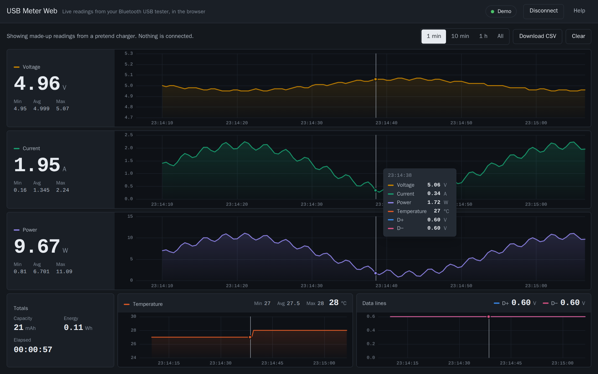

# USB Meter Web

**Your Bluetooth USB tester on a full-screen dashboard, right in the browser.**
No app to install, no account, no ads.

**[Open USB Meter Web →](https://usbmeter.koeda.me)**

Cheap USB testers like the **J7-C** and the **ATorch UD18** measure well, but their phone apps
are slow to pair, full of ads or no longer updated. USB Meter Web reads the same Bluetooth
stream straight from the meter and shows everything it sends, all at once.

## What you get

- **Every reading at a glance.** Voltage, current and power each get a large readout and their
  own graph. Temperature and the USB data lines (D+/D−) sit below, next to capacity, energy and
  elapsed time.
- **One time axis.** Point at any graph and a cursor reads out every value at that moment, so
  you can see what the voltage did when the current jumped.
- **Min, average and max** of each reading for the last minute, 10 minutes, hour or the whole
  recording.
- **CSV export.** Download the recording and keep working on it in a spreadsheet or a script.
- **A device list without the clutter.** The Bluetooth list shows meters, not your keyboard,
  mouse and earbuds.
- **Private by design.** Readings stay in your browser and are never sent anywhere. No cookies,
  no analytics.
- **Desk or pocket.** The dashboard fills a monitor and stacks into one column on a phone, in
  light or dark.
- **No meter at hand?** **Try the demo** plays a pretend charger so you can look around first.

## Use it

1. Plug the meter between a charger and the device you want to measure.
2. Open [usbmeter.koeda.me](https://usbmeter.koeda.me) in **Chrome or Edge** and choose
   **Connect to meter**.
3. Pick the meter in the browser's Bluetooth list. A J7-C shows up as `UC96_BLE`, ATorch meters
   under their model name (`UD18-BLE`, `AT24-BLE`, ...). Readings start right away.

A meter is listed only while the browser can hear it: it needs to be nearby and powered, with
its Bluetooth switched on and no other connection, because these meters talk to one device at a
time. Close the phone app first. If yours is ready and still missing, cancel the list and choose
**Show all Bluetooth devices**. When the page does not know the name of a meter connected that
way, it says so; please [open an issue](https://github.com/koedame/usbmeter/issues) with that
name so it can be added.

## Supported meters

| Meter | Type | Status |
|---|---|---|
| J7-C | USB | Checked against frames recorded from a real J7-C (values match its screen) |
| ATorch UD18 and similar | USB | Checked against published sample packets |
| ATorch AC meters (AC18 and similar) | AC | Checked against published sample packets. Adds frequency and power factor |
| ATorch DC meters, AT24 and others with the same protocol | DC | Experimental: voltage, current, power, temperature and time. Capacity and energy are not decoded yet, because the published layouts disagree |

The type (USB, DC or AC) is read from the data, so a model that is not listed may still work.
If your meter connects but shows nothing, please open an issue with its name and model.

## Browser support

The page uses Web Bluetooth, which **Chrome and Edge** provide on Windows, macOS, Linux, ChromeOS
and Android. Firefox and Safari do not support it, and neither do browsers on iPhone and iPad
(except apps that add it, such as Bluefy). The demo works everywhere.

## Privacy

Everything runs in your browser. Readings are kept in memory while the page is open and are
never sent anywhere. The site's headers forbid scripts from, and connections to, any other
origin, and a test pins them (`public/_headers`, `src/security-headers.test.ts`).

## How it talks to the meter

The meters stream their readings from a serial-over-Bluetooth characteristic (service `0xFFE0`,
characteristic `0xFFE1`). Every frame is `FF 55 <type> <payload> <checksum>`. A report (type
`01`, 36 bytes) carries the device type (`01` AC, `02` DC, `03` USB) and big-endian readings. The
ATorch checksum is the sum of the bytes between the header and the checksum, xor `0x44`. The
J7-C uses a different checksum whose formula is unknown, so its frames are accepted without
checksum verification when they are otherwise well formed.

The layout is based on community notes
([esphome-atorch-dl24](https://github.com/syssi/esphome-atorch-dl24/blob/main/docs/protocol-design.md),
[atorch-console](https://github.com/NiceLabs/atorch-console)) and on the J7-C capture in
[this forum thread](https://forum.arduino.cc/t/usb-digital-tester-bt-protocol/943891). Capacity is
read as mAh (value ÷ 1000 Ah); the UD18 sample packets are consistent with that.

## Contributing

Bug reports, meter names and captures from meters that are not listed are all welcome.
[CONTRIBUTING.md](CONTRIBUTING.md) explains how to run the page locally and how it is tested
without a meter. It is plain TypeScript with no runtime dependencies.

## 日本語

Bluetooth 対応の USB テスター（J7-C・ATorch UD18・AT24 など）の値を、ブラウザのダッシュボードで
見るためのページです。アプリのインストールもアカウントも要りません。

- 電圧・電流・電力を大きな数字とグラフで同時に表示。温度と D+/D− もその下に並びます
- グラフは全部同じ時間軸。どれかにポインタを置くと、その瞬間の全部の値が出ます
- 表示している範囲（1 分・10 分・1 時間・全部）の最小・平均・最大
- 記録は CSV で保存できます
- Bluetooth の一覧にはメーターだけが並びます
- 値はブラウザの中だけで扱い、どこにも送りません

Chrome か Edge（Windows・macOS・Linux・ChromeOS・Android）で
[usbmeter.koeda.me](https://usbmeter.koeda.me) を開き、**Connect to meter** を押してメーターを選びます。
J7-C は `UC96_BLE` という名前で出ます。iPhone・iPad の Safari は Web Bluetooth に対応していません。
メーターが手元に無くても、**Try the demo** で画面を試せます。

## License

MIT. Not affiliated with ATorch or any meter maker; product names belong to their owners.
